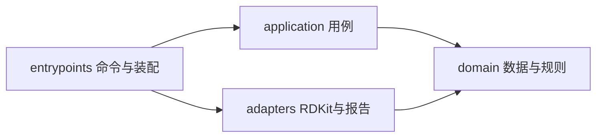

# 工程架构与演进

该仓库同时包含可演进的分子学习主线与已冻结的CYP研究。学习主线执行向内依赖；
CYP平面模块属于明确的历史兼容区，保留原源码和协议哈希，不将它描述成已完成
全量架构迁移。这个边界使新的工具、ESOL和后续研究可以逐步发展而不篡改历史证据。



## 当前目录与职责

```text
src/aidd_agent/
  domain/molecules.py             # 分子样本/分析结果/近邻数据、位集合Tanimoto
  application/checkup.py          # 输入规模/身份约束、逐行失败、近邻筛选
  adapters/rdkit/molecules.py      # RDKit解析、描述符、指纹、结构图
  adapters/reports/checkup.py      # JSON/HTML与新目录文件输出
  entrypoints/checkup.py          # argparse、JSON边界校验、选择实现、来源清单
  molecular_checkup.py            # 原公开API的薄兼容入口
  cli.py、baseline.py、...        # 冻结CYP兼容区，文件清单见cyp-preservation.json
  vendor/openadmet/               # 未改动上游实现和许可
scripts/
  run_molecular_checkup.py        # 原脚本入口，委托已安装命令的main
  cyp/                           # CYP运行/汇总脚本原件
  原CYP脚本名.py                 # 薄执行包装，旧命令继续使用
tests/
  domain/                        # 纯规则
  application/                   # 注入分析能力后的用例决策
  integration/                   # RDKit、报告、命令与兼容行为
  experiments/cyp/               # 原CYP测试，内容不变
  test_architecture.py            # 向内依赖、纯导入、冻结文件哈希
docs/
  learning/                      # 学习计划、课程、个人答案、原始节点摘要
  engineering/                   # 架构、迁移计划、验证与保留清单
  competitions/cyp/README.md      # 冻结研究导航，原件路径不变
examples/learning/                # 手工教学结构，不是活性实验数据
state/                           # 原始数据、运行原件、预测、模型；不进入Git
```

## 依赖与错误规则

- domain仅使用标准库，表达稳定的分子数据与规则；不导入RDKit、sklearn、文件/网络客户端。
- application仅依赖domain和标准库。化学分析通过函数类型注入，运行时由entrypoints
  选择RDKit适配器。用例返回类型化结果，不生成JSON/HTML、不访问路径。
- adapters承担第三方库、描图、序列化和文件写入。报告适配器可调用同属外层的
  RDKit描图实现；将来替换图形后端时调整此边界，不改近邻规则。
- entrypoints是装配根，处理命令和外部JSON类型收窄。导入模块不运行命令；
  重型依赖在实际生成报告时加载，纯领域/用例导入不加载化学/ML库。
- 仅InvalidSmiles转换成逐行错误；意外的计算失败向外传播，不能冒充坏分子。
  验证输入后再写新目录；已有目录拒绝覆盖。写入中断保留失败目录供诊断，换新目录重试。

## 兼容与来源

`aidd-checkup`是规范命令；`python scripts/run_molecular_checkup.py`及
`aidd_agent.molecular_checkup.describe_smiles/run_checkup`保留原参数合同。
原`aidd`CYP命令不改。CYP脚本迁入scripts/cyp，原位置用runpy调用同一原件。
没有重训ESOL、重开CYP确认或重传比赛结果。

新报告manifest使用schema_version=2，保留原统计字段，同时记录entrypoint、
application、domain、RDKit适配器、报告适配器五份源码哈希。molecules.json保持
原数据/描述符/近邻结构；新旧结果独立保存并对账。旧的01-run-summary.json仍指向
56317e8时的原件，不能改它来掩盖源码变更。

新代码不得依赖冻结CYP模块。后续ESOL使用相同的分层约定：实验协议先锁定，
训练/评价由用例编排，文件来源和模型库放适配器；有真实替换/隔离需求才增加端口。
无需预先创建尚未实现的空类、接口或框架。

## 验证与回滚

常规门禁见根README。架构边界由test_architecture.py执行；完整测试需要可选
神经依赖时明确分组，不将skip当作实际运行。CYP文件按[cyp-preservation.json](cyp-preservation.json)
核验，学习输出与56317e8按相同身份逐项比较。安装包还应从仓库外运行命令冒烟。
本轮实现对应[计划](architecture-plan.md)与[验收](architecture-verification.md)。

回滚代码使用历史Git提交；state原件不移动/覆盖，不通过重新生成数据伪造旧哈希。
将来确需修改冻结CYP区域时单独立项、更新来源与验证，不能顺手放宽哈希或提交门槛。
